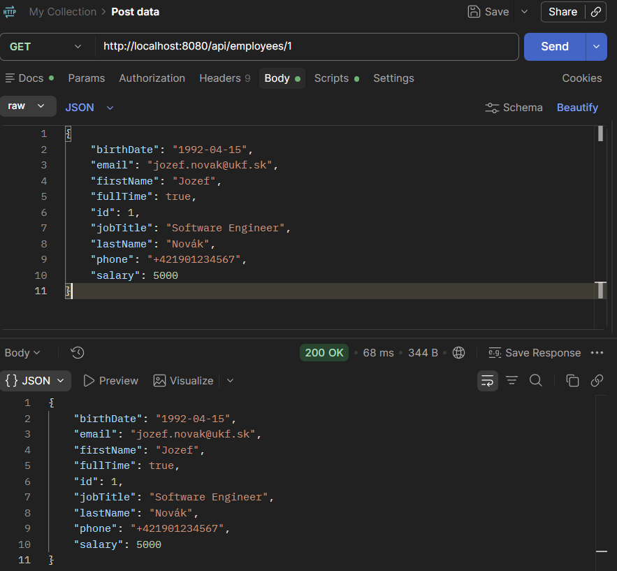
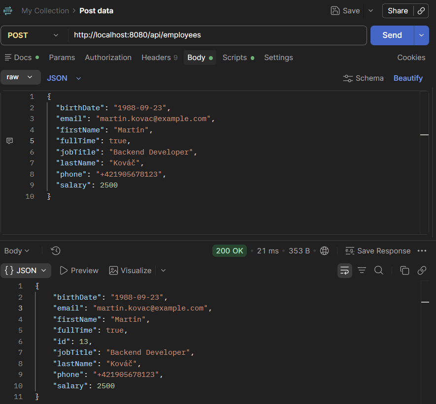
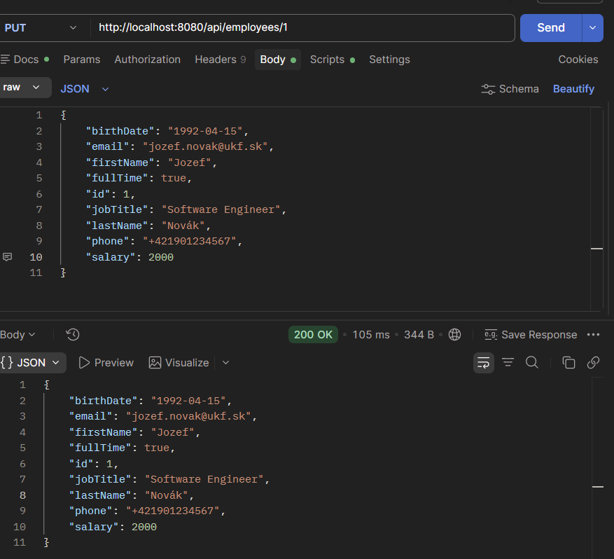
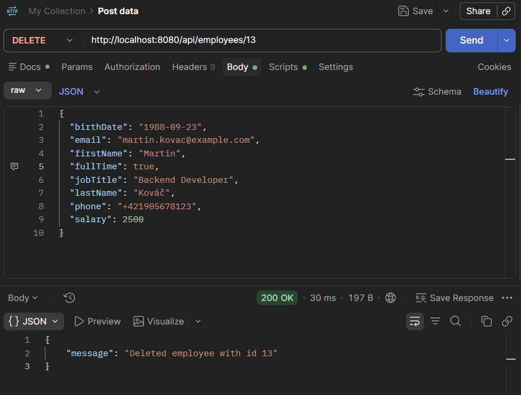
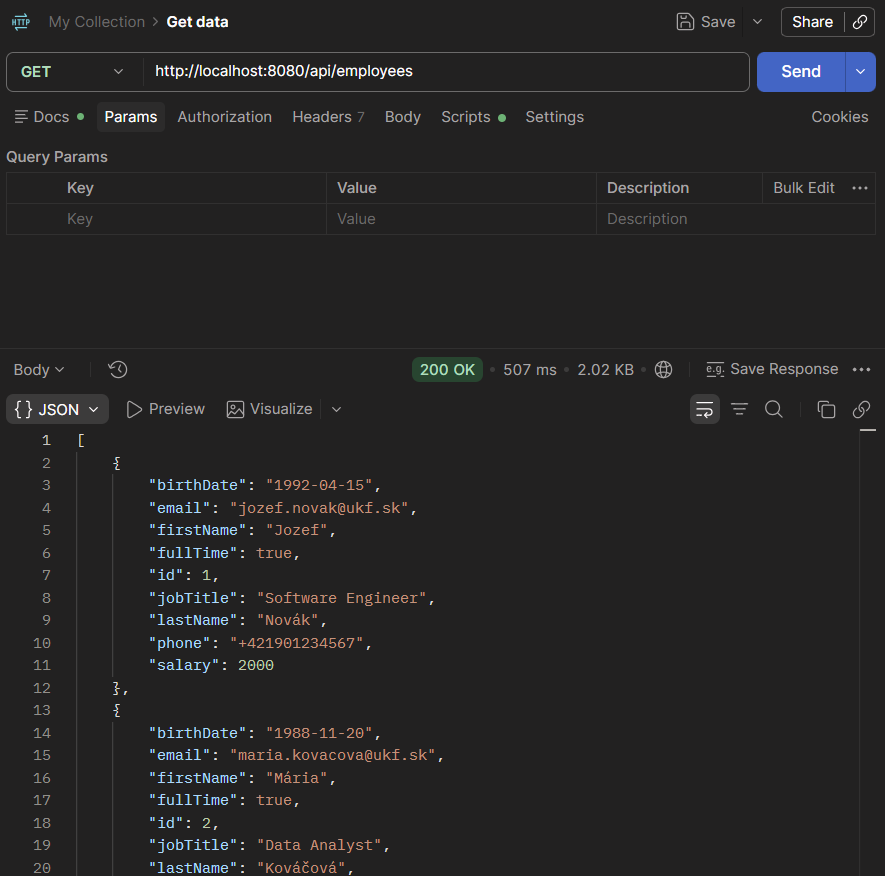

## Before start

1. Copy .env.example into .env
2. Run `docker compose up -d`
3. Start EmployeeDirectoryApplication

## Task 3
### GET /api/employees/{id}

### POST /api/employees

### PUT /api/employees/{id}

### DELETE /api/employees/{id}

## Task 2
