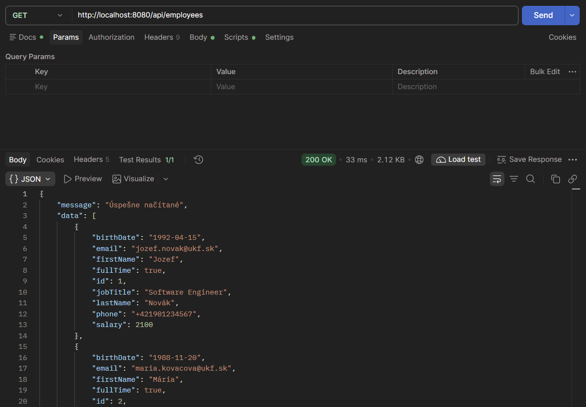
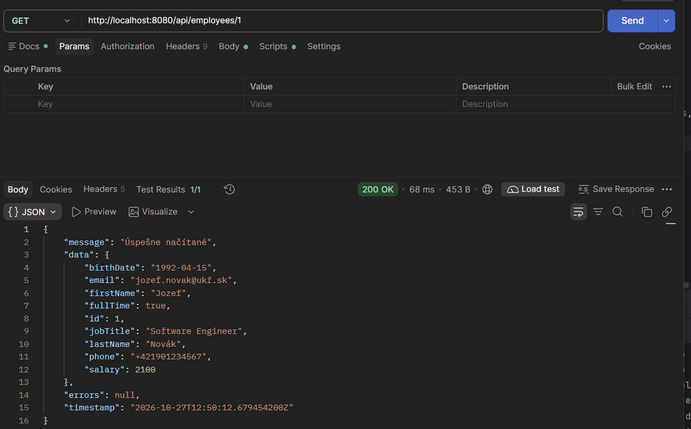
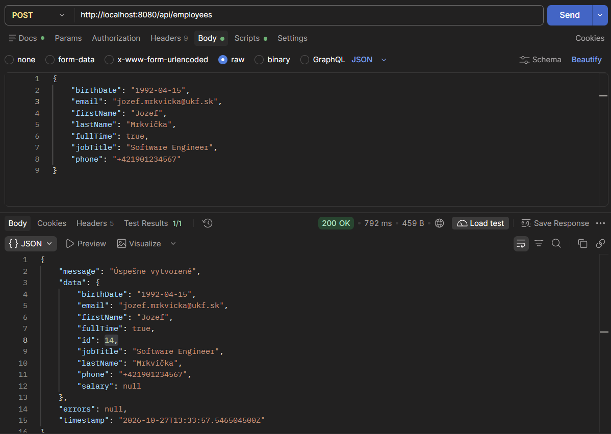
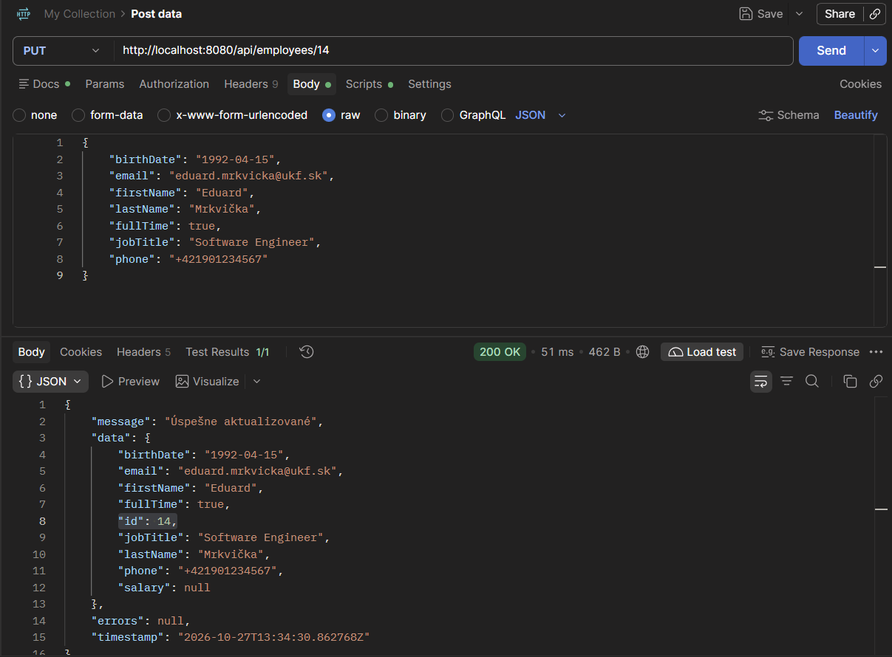
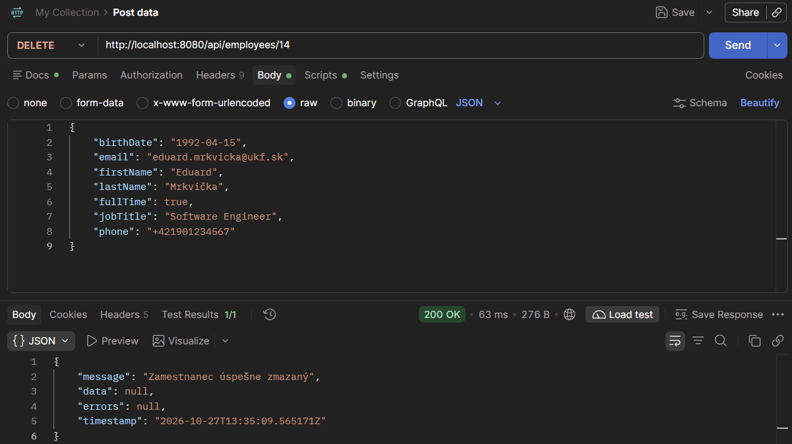
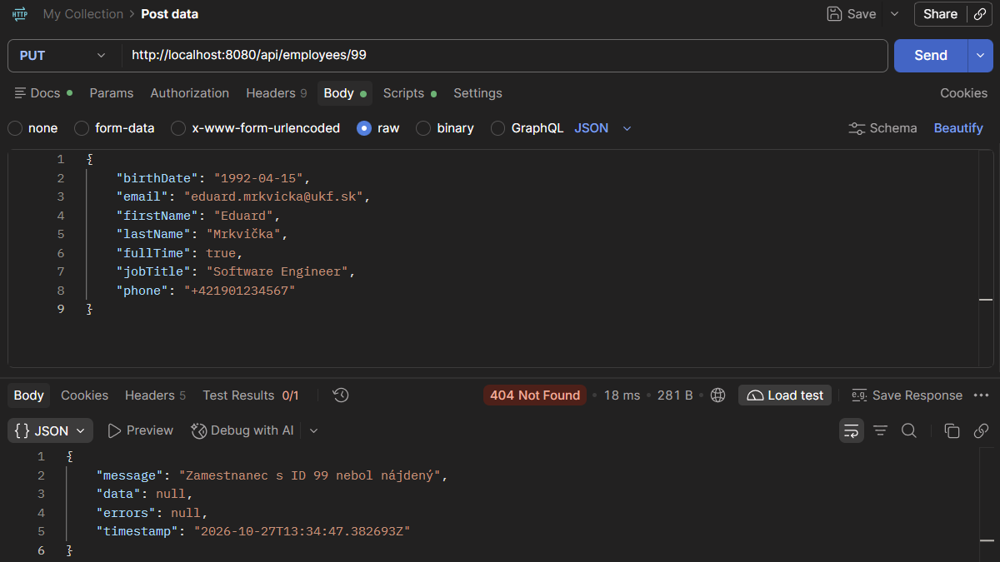
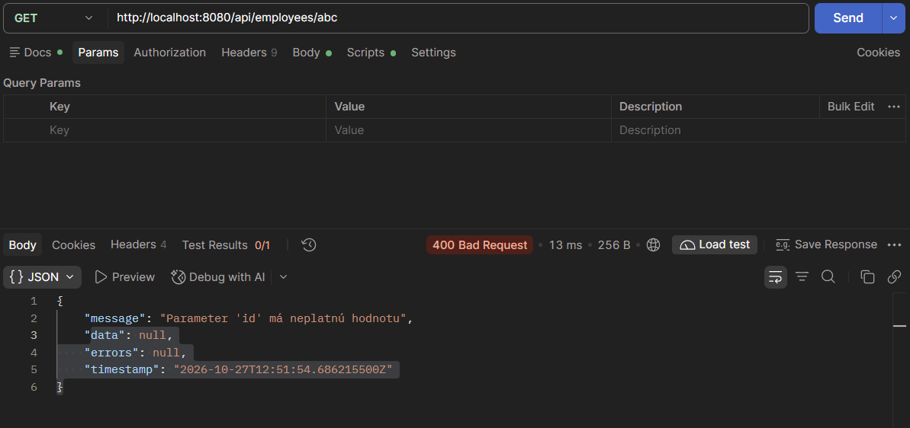
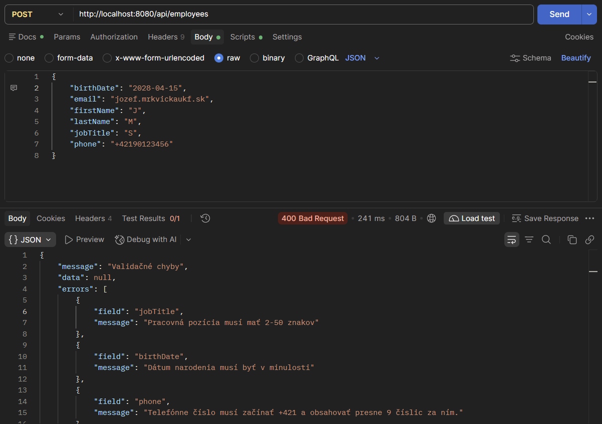
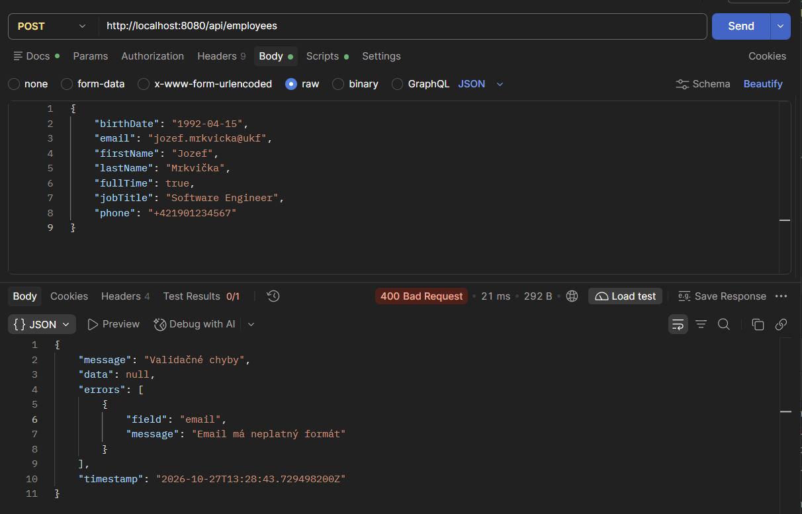
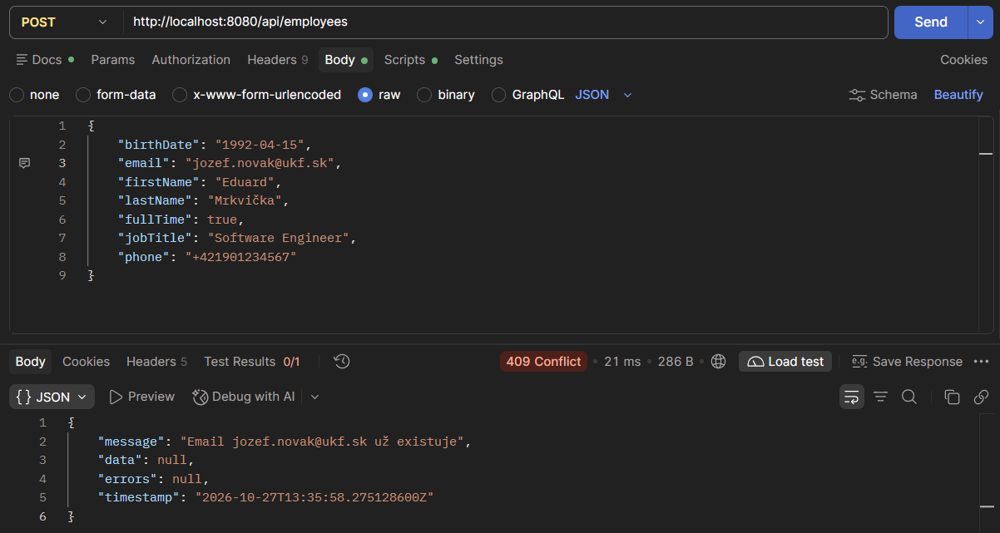

## Before start

1. Copy .env.example into .env
2. Run `docker compose up -d`
3. Start EmployeeDirectoryApplication

## Task 4
### Get all employees - successful response

### Get employee - successful response

### Create employee - successful response

### Edit employee - successful response

### Delete employee - successful response

### Employee not found error

### Invalid employee id format

### Invalid post data

### Not email format in post

### Duplicated email error

## Task 3
### GET /api/employees/{id}

### POST /api/employees

### PUT /api/employees/{id}

### DELETE /api/employees/{id}

## Task 2
